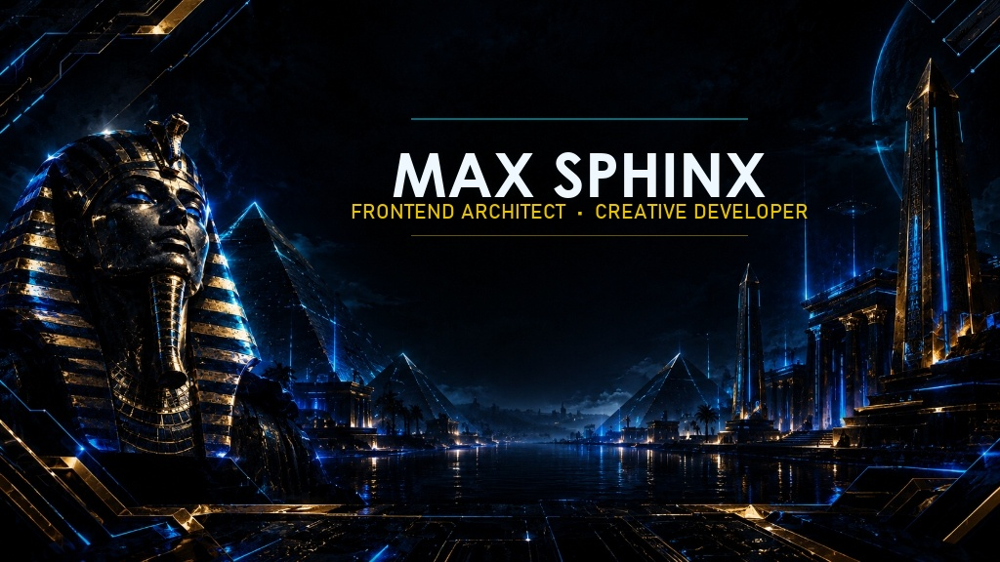

  <!-- Native Banner -->
  

    

  <!-- Social Badges -->
  
  
  

 

### 🚀 Featured Open Source Projects

<table>
  <tr>
    <td width="50%" valign="top">
      <h3 align="left">🛡️ <a href="https://github.com/MaxSphinx/FaceLock">FaceLock</a></h3>
      
<b>Native biometric application shield and intruder defense for macOS.</b> Instant neural camera check on app-switch, intruder capture with night HDR lift, and Telegram alerts.

      

        
        
        
        
      

      

        
        
      

    </td>
    <td width="50%" valign="top">
      <h3 align="left">🔊 <a href="https://github.com/MaxSphinx/Discord-voice-rpc">Discord Voice RPC</a></h3>
      
<b>Dynamic real-time voice presence for Discord.</b> Rich status displays with avatars, group collages, duration counters, and interactive buttons.

      

        
        
        
      

      

        
        
      

    </td>
  </tr>
</table>

---

### 👨‍💻 About Me

- 🛡️ Creator of **[FaceLock](https://github.com/MaxSphinx/FaceLock)** — sub-second biometric security for macOS Apple Silicon.
- 🍏 Passionate about **native macOS engineering** (`Swift`, `AppKit`, `AVFoundation`, `Vision`) and on-device machine learning with Apple Neural Engine.
- 💻 Experienced in building responsive, high-performance web applications using **React, TypeScript, and modern UI architectures**.
- ⚡️ Committed to writing **clean, zero-dependency, privacy-first software** with comprehensive documentation.
- 📍 Based in **Minsk, Belarus 🇧🇾**.

---

### 🛠️ Tech Stack & Tooling

  

 

  
  
  
  
  
  
  

---

### 📊 GitHub Overview

  <!-- Overview Stats -->
  

  <!-- Top Languages -->
  

 

  <!-- Contribution Streak -->
  

---

  ⭐️ <i>«Make it work, make it right, make it fast.»</i> — <b>MaxSphinx</b>

